# Programmable Silicon Retina on Pixel Processor Array

**Maciej Lewandowski¹, Prince Philip², Alexandre Marcireau¹, Chetan Singh Thakur², André van Schaik¹, Piotr Dudek¹**<br>
¹ University of Manchester, UK  ·  ² Indian Institute of Science, Bangalore, India

This repository contains the code, configurations, experiment records and figure notebooks for the paper
*Programmable Silicon Retina on Pixel Processor Array*. It covers three parts of the work:

1. **A multi-stage silicon retina model** (Outer Plexiform Layer → contrast gain control → ON/OFF leaky integrate-and-fire ganglion cells), based on the virtual retina of Wohrer & Kornprobst.
2. **Two implementations of it**: on-sensor, on the SCAMP-5 pixel processor array, and as CUDA kernels driven by a VD55G0 high-speed sensor or video.
3. **A benchmark** of retina events against standard DVS events on video intensity reconstruction and video saliency prediction (DHF1K), using a FireNet-style recurrent network.

<p align="center">
  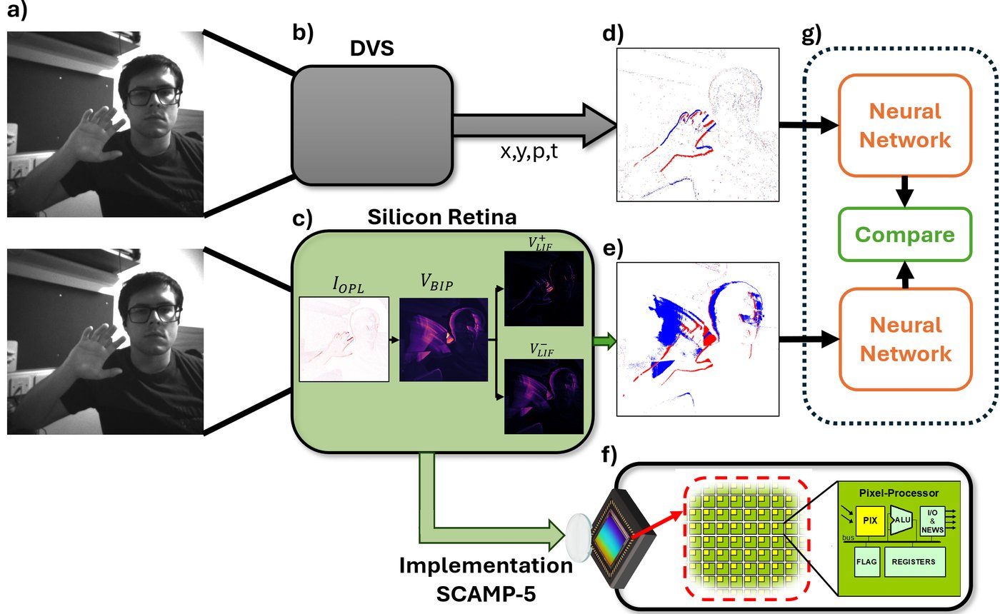
</p>

<p align="center">
  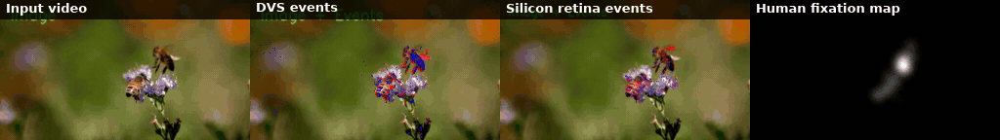
  <br><em>The same DHF1K clip converted to DVS events (ESIM) and to silicon-retina events (this work). The right-hand panel is the human fixation map the network learns to predict.</em>
</p>

---

## Contents

- [Repository map](#repository-map) · [Where is…?](#where-is)
- [Quick start (no dataset needed)](#quick-start-no-dataset-needed)
- [The retina model and its implementations](#the-retina-model-and-its-implementations)
- [Reproducing the experiments](#reproducing-the-experiments): [data](#1-data-and-models) · [pipeline](#2-pipeline) · [figure → code table](#3-paper-figures--code)
- [Hardware](#hardware): [SCAMP-5](#scamp-5-pixel-processor-array) · [VD55G0 live demo](#vd55g0--gpu-live-demo)
- [Reproducibility notes](#reproducibility-notes)
- [Third-party components](#third-party-components) · [Citation](#citation)

---

## Repository map

```text
.
├── src/
│   ├── neural_network/                  # event generation, datasets, training (Python/PyTorch)  → README inside
│   │   ├── experiment/                  #   entry points: saliency / intensity training, BO, occupancy
│   │   ├── configs/                     #   JSON configs for every run (grouped by experiment)
│   │   ├── dataloaders/                 #   DVS + retina event datasets, voxel-grid encodings, FILM upsampling
│   │   ├── networks/                    #   FireNet-style FIRE_network, SaliencyLoss, perceptual loss
│   │   ├── help_scripts/, data_help/    #   dataset preparation (DHF1K / ECOCO)
│   │   └── reusing_videos/esim_torch/   #   CUDA extension: ESIM (DVS) + silicon-retina kernels  ← model used in the paper
│   ├── scamp_code/                      # SCAMP-5 firmware: the retina running on the chip (scamp5_main.cpp)
│   ├── scamp5_demo_code/                # SCAMP-5 host interface + Python viewers for on-chip events
│   ├── silicon_retina_cuda_kernel/      # standalone C++/CUDA retina (no Python), Makefile
│   ├── silicon_retina_python_simulation/# readable NumPy reference + SCAMP-5 fixed-point approximation
│   ├── rt_visualization/                # live GUI: webcam / VD55G0 → GPU retina in real time
│   ├── vd55g0/, hw/                     # ST VD55G0 high-speed sensor SDK + capture scripts
├── scripts/
│   ├── setup/                           # install.sh, download_model.sh
│   ├── paper/                           # one script per paper experiment (run from repo root)
│   ├── smoke_test.py                    # end-to-end check on synthetic data (no download)
│   ├── synthetic_data/                  # tiny synthetic datasets + configs to run every training script
│   └── history/                         # the original job scripts, kept verbatim as a record of what was run
├── paper-figures/                       # notebooks + W&B exports that produce the paper figures  → README inside
├── results/                             # hyper-parameter search studies, dataset-curation plots  → README inside
├── visualizations/                      # rendered example videos (DVS / retina events on DHF1K and ECOCO)
├── docs-src/ → docs/                    # MkDocs project notes, published at https://mlewandowski0.github.io/sillicon-retina/
├── bin/SCAMP5_simulator/                # SCAMP-5 vision-chip simulator (third party) + desktop simulation project
├── media/                               # diagrams (draw.io) and README assets
└── reference/                           # SCAMP-5 programming tutorial
```

### Where is…?

| I want to look at… | Go to |
|---|---|
| The retina model used for all benchmark results | [`src/neural_network/reusing_videos/esim_torch/src/esim_torch/silicon_retina_cuda_kernel.cu`](src/neural_network/reusing_videos/esim_torch/src/esim_torch/silicon_retina_cuda_kernel.cu) and its PyTorch wrapper [`silicon_retina_torch.py`](src/neural_network/reusing_videos/esim_torch/src/esim_torch/silicon_retina_torch.py) |
| The retina running on the SCAMP-5 chip | [`src/scamp_code/src/scamp5_main.cpp`](src/scamp_code/src/scamp5_main.cpp), with its register map in [`PIPELINE_MAP.md`](src/scamp_code/PIPELINE_MAP.md) |
| A short, readable version of the equations | [`src/silicon_retina_python_simulation/paper_impl.py`](src/silicon_retina_python_simulation/paper_impl.py) (float) and [`sillicon_retina_scamp_approx.py`](src/silicon_retina_python_simulation/sillicon_retina_scamp_approx.py) (SCAMP-5 fixed-point approximation) |
| The neural network and loss | [`networks/FIRE_network.py`](src/neural_network/networks/FIRE_network.py), [`networks/SaliencyLoss.py`](src/neural_network/networks/SaliencyLoss.py) |
| How events become network input | [`dataloaders/Encodings.py`](src/neural_network/dataloaders/Encodings.py), [`dataloaders/SiliconRetinaEventDatasetFromUpsampledSaliency.py`](src/neural_network/dataloaders/SiliconRetinaEventDatasetFromUpsampledSaliency.py) |
| The training loops | [`experiment/saliency_using_FIREnetwork_silicon_retina.py`](src/neural_network/experiment/saliency_using_FIREnetwork_silicon_retina.py) (retina), [`experiment/saliency_using_FIREnetwork_events_v2.py`](src/neural_network/experiment/saliency_using_FIREnetwork_events_v2.py) (DVS) |
| The exact parameters of a run | [`src/neural_network/configs/`](src/neural_network/configs/), mapped to figures in [`scripts/paper/`](scripts/paper/) |
| How a figure was made | [`paper-figures/README.md`](paper-figures/README.md) |

---

## Quick start (no dataset needed)

Requirements: Linux, an NVIDIA GPU, a CUDA toolkit (`nvcc`) and Python ≥ 3.10.

```bash
git clone https://github.com/mlewandowski0/sillicon-retina.git
cd sillicon-retina
python -m venv .venv && source .venv/bin/activate
bash scripts/setup/install.sh          # PyTorch (cu130 wheel; edit for your CUDA), requirements, builds esim_torch
python -m scripts.smoke_test           # ~1 min
```

The smoke test generates a synthetic clip and runs it through the same code as the paper. It simulates DVS events (ESIM) and silicon-retina events (CUDA kernels), encodes both as voxel grids, and runs one FireNet + saliency-loss training step on each. It ends with:

```text
DVS    events:   40828  (3.38% of pixel-frames)
Retina events:   87964  (7.28% of pixel-frames)
FireNet (33233 params) one training step on DVS    voxel grids: loss = 1.7548
FireNet (33233 params) one training step on Retina voxel grids: loss = 1.6798
SMOKE TEST PASSED
```

To run the **actual training and analysis entry points** on a tiny synthetic dataset (2 epochs, about 1 min), covering retina and DVS saliency, event occupancy, and retina and DVS intensity reconstruction:

```bash
bash scripts/synthetic_data/run_synthetic_pipeline.sh
```

> If the `esim_torch` build fails with an architecture error, set your GPU's compute capability explicitly, e.g.
> `TORCH_CUDA_ARCH_LIST="8.6" pip install -e src/neural_network/reusing_videos/esim_torch --no-build-isolation`.

To run the paper-figure notebooks you only need the CPU packages: `pip install -r requirements.txt`, then open `paper-figures/*.ipynb` with `paper-figures/` as the working directory.

---

## The retina model and its implementations

<p align="center">
  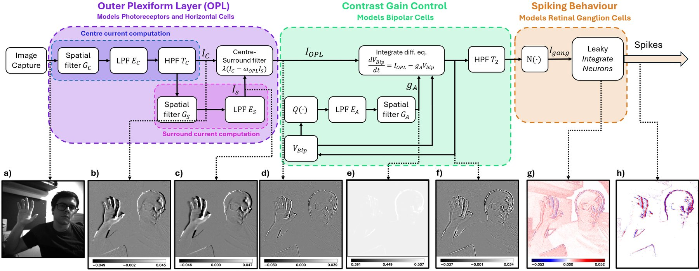
</p>

The model has three stages, each computed per pixel and per frame:

| Stage | What it computes | Key parameters (config names) |
|---|---|---|
| **Outer Plexiform Layer** | Centre–surround band-pass filter: I<sub>OPL</sub> = λ(I<sub>C</sub> − ω I<sub>S</sub>) | `alpha1`, `alpha2`, `lambda_OPL`, `HPF1_mode`, `kernel1_*` |
| **Contrast gain control** (bipolar) | Leaky integrator dV<sub>BIP</sub>/dt = I<sub>OPL</sub> − g<sub>A</sub>V<sub>BIP</sub>, where g<sub>A</sub> = G<sub>A</sub> ∗ E<sub>A</sub> ∗ Q(V<sub>BIP</sub>) is the spatially and temporally filtered feedback | `G_A_zero`, `lambda_A`, `q_feedback_mode` (0 = V², 1 = \|V\|), `turn_off_feedback`, `kernel2_*` |
| **Ganglion cells** | Rectified current N(T₂ ∗ V<sub>BIP</sub>) drives ON and OFF LIF neurons that emit spikes | `p1`, `p2`, `p3`, `I_bias_on/off`, `U_th_on/off`, `U_reset_on/off`, `HPF2_mode` |

The same model exists in several implementations, which share parameter names:

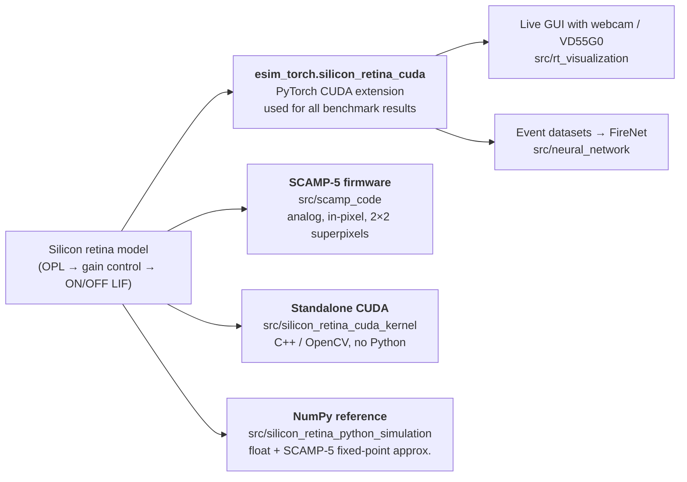

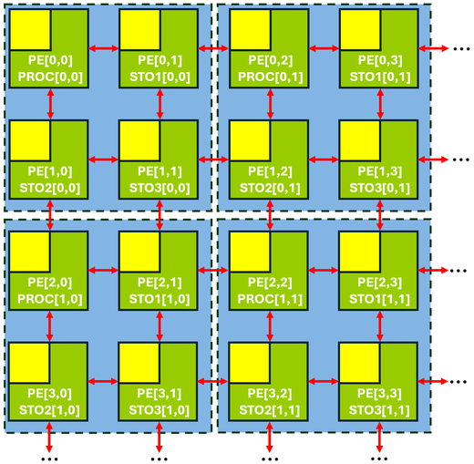

On SCAMP-5, each 2×2 block of processing elements forms a superpixel: one PE computes and three store state. This works around the six analog registers available per pixel. Multiplications use 5-bit fixed-point analog arithmetic. The full register map and per-frame timeline are in [`src/scamp_code/PIPELINE_MAP.md`](src/scamp_code/PIPELINE_MAP.md).

<br clear="right">

The recording below shows the retina running live on the SCAMP-5 chip. Left: the ganglion-cell LIF membrane potential. Right: the resulting ON spikes. It was made with an earlier firmware version. In that version it was difficult to read out the LIF membrane potentials and both the ON and OFF spikes from the chip at the same time, so only the ON channel is shown.

<p align="center">
  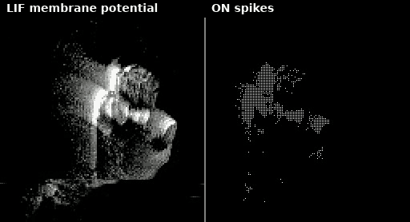
</p>

> [!NOTE]
> **TODO:** we will add recordings from the CVPR 2026 demo app, which displays ON and OFF events simultaneously (red/blue). That demo app was presented on CVPR Workshop [Implementation of a Retina Model on the SCAMP-5 Vision Sensor](https://onsensor-vision.github.io/html/Implementation_of_a_Retina_Model_on_the_SCAMP-5_Vision_Sensor.html) (On-Sensor Vision Workshop, CVPR 2026).

Real on-chip outputs over time (I<sub>OPL</sub>, V<sub>LIF</sub> and the spike map):

<p align="center">
  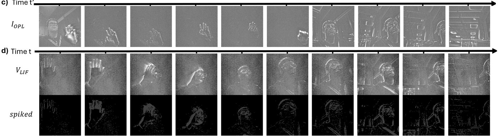
</p>

---

## Reproducing the experiments

<p align="center">
  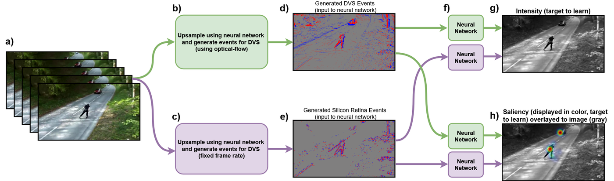
</p>

### 1. Data and models

None of these are in the repository. All paths are relative to the repository root, and every script must be run from the root.

| What | Where the code expects it | How to get it |
|---|---|---|
| FILM interpolation weights | `models/film_net/Style/saved_model` | `bash scripts/setup/download_model.sh` |
| DHF1K (saliency) | `src/neural_network/data/saliency_dataset_processed` → `…_truncated` → `…_upsampled` → `…_ready/{train,val}` | Download DHF1K, then follow [src/neural_network/README.md](src/neural_network/README.md#dataset-preparation) |
| ECOCO (intensity reconstruction) | `src/neural_network/data/ecoco_depthmaps_test` → `upsampled_{train,validation}` | `mkdir -p src/neural_network/data && cd src/neural_network/data && bash ../download.sh && unzip ecoco_depthmaps_test.zip` (48 GB) |

DVS and retina events are generated on the fly from the upsampled videos the first time each video is used. They are cached as `cache_*.npy` next to the video.

### 2. Pipeline

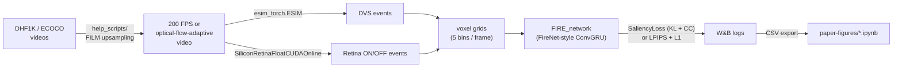

Every experiment is a single command run from the repository root:

```bash
python -m src.neural_network.experiment.<module> -c src/neural_network/configs/<group>/<config>.json
```

### 3. Paper figures → code

| Paper figure | Training runs (`scripts/paper/`) | Figure notebook (`paper-figures/`) |
|---|---|---|
| Visual abstract, retina pipeline | (no training) | `visualization_figures/run_whole.py`, `visualization_figures/abstract_and_digital_output.ipynb` |
| Intensity reconstruction, DVS vs Retina | [`intensity_reconstruction.sh`](scripts/paper/intensity_reconstruction.sh) | `analysis_intensity.ipynb` |
| Saliency prediction, DVS vs Retina | [`saliency_main_comparison.sh`](scripts/paper/saliency_main_comparison.sh) | `analysis_saliency.ipynb` |
| Feedback formulation (none / \|V\| / V²) | [`saliency_feedback_ablation.sh`](scripts/paper/saliency_feedback_ablation.sh) | `analysis_saliency.ipynb` |
| High-pass filter formulation | [`saliency_hpf_ablation.sh`](scripts/paper/saliency_hpf_ablation.sh) | `analysis_saliency.ipynb` |
| Spatial kernel size | [`saliency_kernel_ablation.sh`](scripts/paper/saliency_kernel_ablation.sh) | `analysis_saliency.ipynb` |
| Loss vs event sparsity | [`saliency_sparsity_sweep.sh`](scripts/paper/saliency_sparsity_sweep.sh) | `analysis_saliency.ipynb` |
| Fixed-rate vs optical-flow upsampling | see [paper-figures/README.md](paper-figures/README.md) | `analysis_saliency.ipynb` |
| Retina parameter search | [`hyperparameter_search.sh`](scripts/paper/hyperparameter_search.sh) | studies in [`results/hyperparameter_search/`](results/hyperparameter_search/) |

<p align="center">
  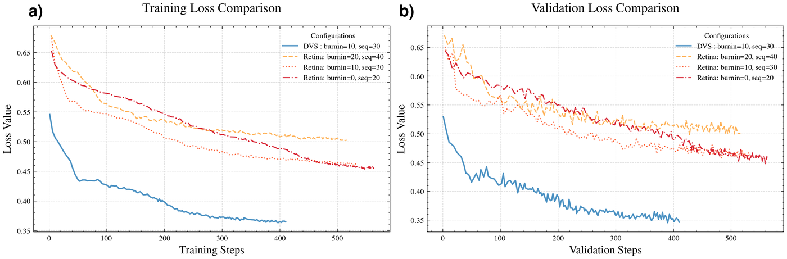
  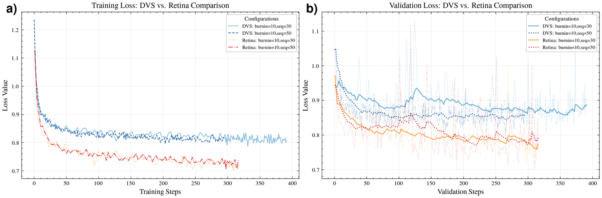
  <br><em>Left: intensity reconstruction, where DVS events do better. Right: saliency prediction, where retina events do better.</em>
</p>

The figure notebooks read the W&B exports in `paper-figures/analysis/*.csv`, so they re-create every plot without re-training. The table in [paper-figures/README.md](paper-figures/README.md) lists every output file and its input.

<p align="center">
  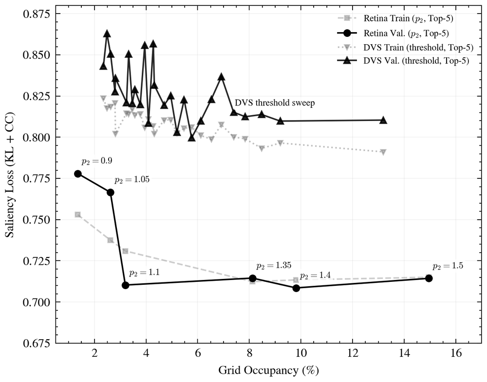
  <br><em>Saliency validation loss vs. event-grid occupancy: a sweep of the retina ganglion gain p₂ against a sweep of the DVS contrast threshold.</em>
</p>

---

## Hardware

### SCAMP-5 pixel processor array

* **Firmware**: [`src/scamp_code/`](src/scamp_code/) is an MCUXpresso (Eclipse CDT) project for the SCAMP-5d M0 core. Import it into an MCUXpresso workspace that also contains the SCAMP-5d SDK projects (`s5d_m0`, `s5d_m4`, `lpc_chip_43xx_m0`). Then build the *Release* configuration and flash it with the SCAMP-5d tools. The SDK is distributed by the University of Manchester and is not part of this repository.
* **Viewing events on the host**: build the `scamp` Python module in [`src/scamp5_demo_code/interface/`](src/scamp5_demo_code/interface/), then run `scamp_python_minimal/show_events.py` (ON/OFF events) or `show_events_with_lifs.py` (events + membrane potentials). Alternatively, use the SCAMP-5d Host App.
* **Desktop simulation**: [`bin/SCAMP5_simulator/sim_example/`](bin/SCAMP5_simulator/sim_example/) is a Visual Studio project, built against the SCAMP-5 simulator (`bin/SCAMP5_simulator/bin/scamp5_sim_server.exe`). It contains an earlier version of the retina.

### VD55G0 + GPU live demo

[`src/rt_visualization/`](src/rt_visualization/) runs the CUDA retina live, with an interactive parameter GUI (dearpygui), on either a webcam (`live_cam_laptop.py`) or the ST VD55G0 high-speed sensor (`live_cam_vd55g0.py`). It needs `esim_torch` installed (see Quick start). Run the scripts from their own folder, because the sensor library is loaded from the working directory. `record_hs_video.py` records the high-speed input used for the qualitative figures.

---

## Reproducibility notes

* **Run everything from the repository root.** Imports are absolute (`src.neural_network…`) and all data, config and output paths are relative to the root. The only exceptions are the figure notebooks, which run from `paper-figures/`, and the hardware scripts, which run from their own folder.
* **Configs ↔ runs.** `wandb_prefix` / `wandb_name` in each config is the run name that appears in the CSV exports in `paper-figures/analysis/`. The original job scripts in [`scripts/history/`](scripts/history/) are kept unchanged. A few of them reference configs that were renamed or edited later.
* **Config styles.** The intensity-reconstruction configs predate commit `6d90ca1` and use an `out_sigmoid` flag where later configs use `out_mode`. The current code accepts both. Those configs set `add_bn: false`, so the later change of normalisation layer (BatchNorm → GroupNorm in the input head) does not affect them.
* **Generated outputs.** Experiments write `result.json`, Optuna databases and `temp_config_trial_*.json` to the working directory, and checkpoints to `src/neural_network/checkpoints/`. These are git-ignored.

## Third-party components

| Path | Origin |
|---|---|
| `src/neural_network/reusing_videos/` | Adapted from [vid2e](https://github.com/uzh-rpg/rpg_vid2e) (Gehrig et al., CVPR 2020). `esim_torch` is extended here with the silicon-retina CUDA kernels |
| `src/neural_network/reusing_videos/upsampling/utils/model.py` | From [Super-SloMo](https://github.com/avinashpaliwal/Super-SloMo) |
| `src/silicon_retina_cuda_kernel/cnpy.*` | [cnpy](https://github.com/rogersce/cnpy) |
| `bin/SCAMP5_simulator/`, `src/scamp5_demo_code/interface/` | SCAMP-5 simulator and host interface, © The University of Manchester |
| `src/vd55g0/`, `src/hw/`, `src/rt_visualization/` (sensor library + `*_sdk.py`, `vd55g0_*.py`) | ST BrightSense VD55G0 SDK, © STMicroelectronics |
| `reference/tutorial.*` | SCAMP-5 programming tutorial ([Scamp5-Tutorial-Examples](https://github.com/lauriebose/Scamp5-Tutorial-Examples)) |
| FILM weights (downloaded) | [FILM](https://github.com/google-research/frame-interpolation), via the vid2e model archive |

## Citation

```bibtex
@misc{lewandowski_silicon_retina,
  title  = {Programmable Silicon Retina on Pixel Processor Array},
  author = {Lewandowski, Maciej and Philip, Prince and Marcireau, Alexandre and
            Thakur, Chetan Singh and van Schaik, Andr{\'e} and Dudek, Piotr},
  note   = {Code: https://github.com/mlewandowski0/sillicon-retina}
}
```
