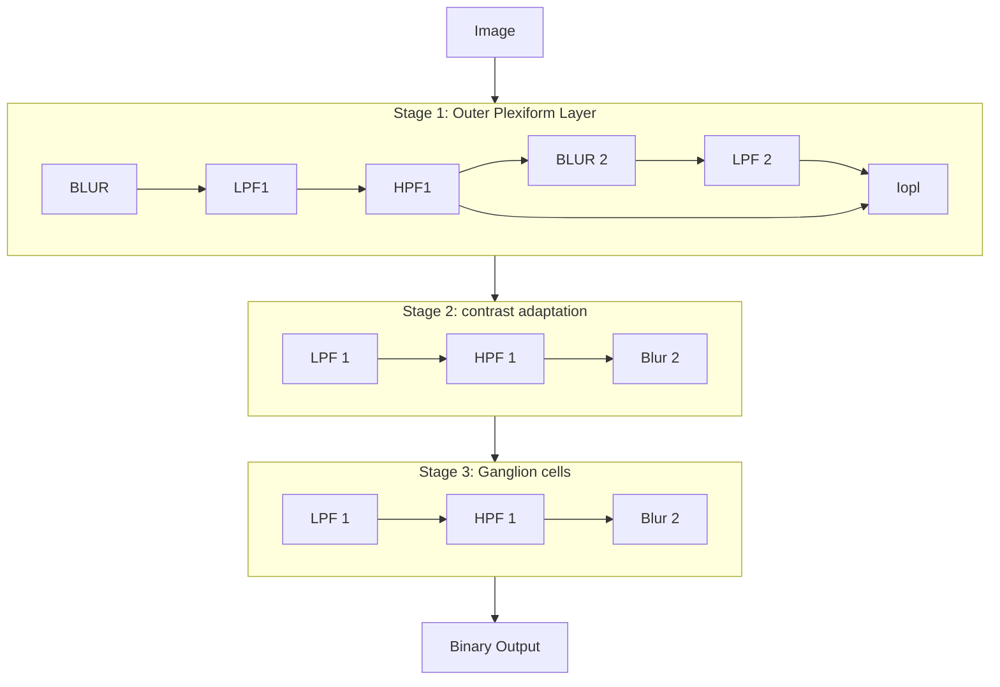

# Sillicon Retina Model
## Stage 1

The first stage is generating the current coming from Outer Plexiform Layer (OPL), which can modeled as [1] :

\[
\begin{align}
\label{blur1} Blurred_1 &:= G_{1} * L \\[2ex]
\label{LPF1} LPF_1 &:= E_{1} * Blurred_1 \\[2ex]
\label{HPF1} HPF_1 &:= T_{1} * LPF_{1} \\[2ex]
\label{blur2} Blurred_2 &:= G_{2} * HPF_{1} \\[2ex]
\label{LPF2} LPF_2 &:= E_{2} * Blurred_{2} \\[2ex]
\label{Iopl} I_{OPL} &:= \lambda_{OPL} \left( HPF_1 - \omega_{OPL} LPF_2 \right)
\end{align}
\]

- Where any filter \( G_{C} \) represents a kernel corresponding to gaussian blur, \( E \) corresponds to temporal low pass filter and \( T \) represents temporal high pass filter.
- The blur kernels \( G \) represents the gap junctions between the neurons. In the outer plexiform layer, photoreceptors and horizontals cells are linked through these junctions. Horizontal cells, have broader receptive fields (larger kernels) while the photoreceptors have smaller receptive fields (small kernel).
- The neuron responses are approximated by temporal filters. The temporal low-pass filters starts at photoreceptor (eq \( \ref{blur1} \)) and the delays formed by neurons (neurotransmitter release, diffusion ) are captured by the Low Pass Filters. The photoreceptors respond to light but are slow. The low pass filtering helps us to capture that behaviour.
- HPF occurs due to bipolar + amacrine cells. They are senstivie to temporal constrast and pass only new changes.
- Outer Plexiform Layer was modeled to have a bandpass reponse, using a Difference of Gaussians (DoG) and Difference of Expoential (DoE) filters [1].

## Stage 2

In the next stage we compute the Contrast Adaptation, which is due to some of the cells (certain bipolar, amacrine and all ganglion cells [2]). This was done as below [1] :

\[
\begin{align}
\label{Bipcells} C \frac{dV_{bip}}{dt} &:= I_{OPL} - g_{A} V_{bip} \\[2ex]
\label{contrastgain} g_{A} &:= G_{3} * E_{3} * Q(V_{bip}) \\[2ex]
\label{Qfunc} Q(V_{bip}) &:= G_{A}^{0} + \lambda_{A} V_{bip}^2
\end{align}
\]

- the equation \( \ref{Bipcells} \) models just a leaky integrate neurons (or low pass filtering), with a "varied" resistance
- Appling filters \( G*{3} \) and \( E*{3} \) represents both temporal and spatial smoothing of amacrine cells
- the Q function is a nonlinear control function, representing the strength of the feedback loop.

## Stage 3

- the last stage models the spiking behaviour of the retina. It sends the information from the photoreceptor, horizontal, bipolar, amacrine cells (non-spiking) to a model of ganglion cells, which will produce the spikes.

\[
\begin{align}
\label{HPF2} HPF_{2} &:= T_{2} * V_{bip} \\[2ex]
\label{Igang} I_{gang} &:= N(HPF_{2}) \\[2ex]
\label{Vlif} \tau_{m} \frac{dV_{LIF}}{dt} &:= - |V_{LIF} - V_{rest}| + R I_{gang}
\end{align}
\]

The \( V\_{LIF} \) is a membrane of the leaky integrate fire neuron, after which we can can threshold it with some \( \theta \) and do firing.

\[
OUT:=\begin{cases}
1, & \text{if } V\_{LIF} >= \theta \\
0, & \text{otherwise}
\end{cases}
\]

And then the reset mechanism is implemented.

# SCAMP5 Implementation

## High level overview

This sillicon retina model is too big to implement on the whole

<figure>
  
  <figcaption> Partitioning of the sillicon retina on SCAMP5. The Sillicon Retina model requires quite a bit of memory, storing values from low pass and high pass filters. This is problematic on SCAMP5, therefore a grid of 256x256 is split into a 2 by 2 cells, reducing the resolution to 128x128, however allowing for much more memory. </figcaption>
</figure>

## Mapping the equations on SCAMP

### Blur

Blur (equations \( \ref{blur1}, \ref{blur2}, \ref{contrastgain} \)): for a value, for example stored in PROC.A, we copy it to STO1.A, STO2.A and STO3.A. after that we can simply apply `gauss(A, A, ITERATIONS)`

### Low Pass Filters

Low Pass Filters (equations \( \ref{LPF1}, \ref{LPF2}, \ref{contrastgain} \)) : this is implemented as exponential smoothing from 2 reasons : it's very simple and possible to implement on SCAMP, and has very simillar form as leaky integrate and fire equation. This uses the following equation :

\[
\begin{align}
V_{0} &= I_{0} \\
V_{n} &= V_{n-1} + \alpha(I_{n} - V_{n-1})
\end{align}
\]

\( \alpha \) should be a value from [0, 1] and controls how fast or not we want to interpolate inbetween the frames. This computation (and other multiplications by a fixed value can be represented by the C code below). To unify this with other multiplication by constant later, the LPF is specified firstly by number of bits \( N \), and then then the value of actual filter is specified in fixed point format \( b_{1}.b_{2}b_{3}...b_{N} \).

```C++
struct fixed_point_mult
{
    int no_bits;
    int value;
};

// here 5 bits represent
fixed_point_mult LPF1 = {5,
                        0b01000};

void apply_LPF_with_I_in_A_V_in_B(fixed_point_mult &lpf)
{
    // incoming value of I_{n} is in A
    // previous map of V_{n-1} is in B
    // store the delta of I_{n} - V_{n-1} in C

    scamp5_kernel_begin();
      WHERE(IS_PROC);
        sub(C, A, B);
    scamp5_kernel_end();


    bool first_msb=true;
    int msb = 1 << (lpf.no_bits - 1);

    while (msb)
    {
      // the first bit for LPF should always be 0. we can detect this
      // but it isn't necessary (if we assume the values provided will be correct)
      /*
      if (first_msb)
      {
        first_msb = false;
        continue;
      }
      */
      if (msb & lpf.value)
      {
        scamp5_kernel_begin();
           add(B, B, C);
           diva(C, E, F);
        scamp5_kernel_end();
      }
      else
      {
        scamp5_kernel_begin();
          diva(C, E, F);
        scamp5_kernel_end();
      }
      msb >>= 1;
    }
    // the result is now stored in B
}
```

### High Pass Filters

simple high pass filter (RC filter) can be implemented as the equation below

\[
y_i = \alpha y_{i-1} + \alpha (x_{i} - x_{i-1})
\]

however in practice this didn't work so well. In the current version of the model the following equation is implemented :

\[
y_{i} = x_{i} - x_{i-1}
\]

### Outer Plexiform Layer

The equation for Outer Plexiform Layer ( Equation \( \ref{Iopl} \)) is computed as below:

\[
I_{opl} = \lambda_{OPL} (HPF_1 - LPF_2)  
\]

where \( \lambda_{OPL} \) should amplify the signal bit. One simple assumption to make is that because we want to amplify signal, we can very easily multiply the signal by 2s 
just by executing ```ADD R1, R1, R1``` (to multiply for 4 we should execute this twice, for 8 execute thrice etc.). To avoid amplifying noise and small signals, we can measure the strength of the signal by taking the absolute value, and if the values are small (smaller then certain threshold), after repeatedly adding, we will zero them out (take absolute value, load threshold, compare to threshold, store the comparison in some DREG (for example S0), execute 'multiplication', for values stored in S0, set them to 0).

 This simple "fake" amplification is used, which will enhance the noise, however will make the numbers bigger :
```C++
if (amplify_opl > 0)
{
 	// take the absolute value of A and save it in F
 	scamp5_kernel_begin();
 		abs(F, A);
    WHERE(DREG_PE);
      mov(B, F);
  scamp5_kernel_end();

  // load the value of threshold into F
  scamp5_load_in(F, amplify_opl_thresh);

  scamp5_kernel_begin();
    WHERE(DREG_PE);
      sub(B, B, F);

      // store in I_OPL_SMALLER_THAN_THRESHOLD the values for which the A is smaller then threshold and is part of PE
    where(B);
    NOT(I_OPL_SMALLER_THAN_THRESHOLD, FLAG);
    AND(I_OPL_SMALLER_THAN_THRESHOLD, I_OPL_SMALLER_THAN_THRESHOLD, DREG_PE);

    WHERE(DREG_PE);
  scamp5_kernel_end();

  for (int i = 0; i < amplify_opl; ++i)
  {
    scamp5_kernel_begin();
      mov(F, A);
      add(A, A, F);
    scamp5_kernel_end();
  }

  scamp5_load_in(F, 0);
  
  // zero out the values that were small in the beginning
  scamp5_kernel_begin();
    WHERE(I_OPL_SMALLER_THAN_THRESHOLD);
      mov(A, F);
  scamp5_kernel_end();
}
```

### Contrast Adaptation
The Stage 2 is quite complex and very sensitive. The values of \( I_{OPL} \) are not large and if some of the fake amplification is done, there is going to be tons of noise
Firstly, \( Q \) function is approximated as : 

\[
    Q(V_{bip}) G_{A}^{0} + \lambda_{A} V_{bip}^{2} \approx G_{A}^{0} + \lambda_{A}^{*} |V_{bip}|
\]

The differential equation for bipolar cell voltage is solved using euler method (it is likely, this is the only way to solve it on current SCAMP5 system). This becomes

\[
\begin{align}
  & V_{bip}[n+1] \approx V_{bip}[n] + \frac{h}{C} (I_{OPL} - g_{A} V_{bip}) = \\[2ex]
  &= V_{bip}[n] + p_1 (I_{OPL} - g_{A} V_{bip}) \\[2ex]
  &=  
\end{align}
\]

implementing of the multiplication of \( p_1 \) is fairly straightforward using the previously developed procedure for low pass filters. multiplication of \( g_{A} V_{bip} \) is more difficult because it is, per element multiplication (not a single scalar value). This computation is done by computing g_{A} in analog domain, and then digitizing the values, and storing the 3 MSBs in the DREG. With these 3 bits, we can quite easily modify the multiplication by fixed point value procedure, however there, instead of using the struct value, we use the WHERE(DREG_CURRENT_BIT) and make that operation. 


### Ganglion Current function
Ganglion Current function is quite complex and was skipped so far. In the current implementation it is approximated as :

\[
  N(X) = max(X, 0) + I_{Bias}
\]

### Leaky Integrate and Fire Neurons

The leaky integrate and fire neurons are implemented as following : 

\[
  \begin{align}
    V_{LIF}[n+1] &= V_{LIF}[n] + \frac{h}{\tau}(I_{gang} R - |V_{lif}[n] - V_{rest}|) = \\
    &= V_{LIF}[n] + p_{2} (p_{3} I_{gang} - |V_{lif}[n] - V_{rest}|) \\ 
    &= V_{LIF}[n] + p_{2}' I_{gang} - p_{3}' |V_{lif} - V_{rest}|
  \end{align}
\]

Here, the \( p_1, p_2 \) are again fixed point parameters, and we can reuse the already existing code for "fixed point multiplication", showed before.


## Sillicon Model on Scamp : Computation Flow

Below is a high‐level flow of the data processing stages:



# references

- [1] Neuromorphic Retina: An FPGA-based Emulator
- [2] Fast and Slow Contrast Adaptation in Retinal Circuitry
