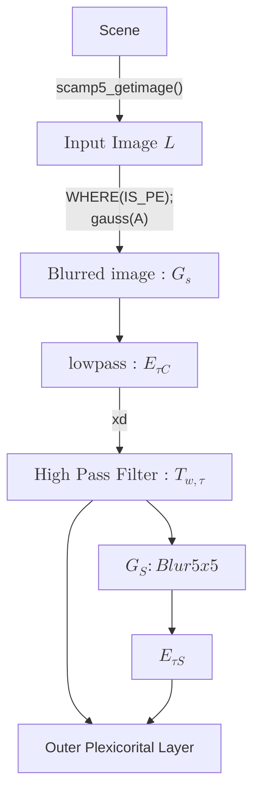

# Block Diagram : Sillicon Retina Pipeline

# Mapping to SCAMP 
```
%% ------------------------------------------------------------
%% Configuration block  (keeps HTML labels & tweaks spacing)
%% Put this *once* at the top of any .md file that contains 
%% Mermaid diagrams if you haven’t already.
%% ------------------------------------------------------------
%%{ init:  {
      "flowchart": {
        "htmlLabels": true,      /* allow inline <div>  */
        "nodeSpacing": 25,
        "rankSpacing": 30
      },
      "theme": "default"
    }
}%%

flowchart LR
    %% ========================================================
    %% 1) THE 4-TILE CLUSTER
    %% ========================================================
    subgraph tileCluster ["<b>Receptive-field tile</b>"]
        direction TB            %% draw inner nodes top-to-bottom first,
        %% but we’ll force them into a grid with invisible links.

        %% ---- Node definitions (identical fixed-size boxes) ----
        t1["<div style='width:140px;height:110px'>
               <b>A</b> — pre-gain<br/>
               <b>B</b> — threshold<br/>
               <b>C</b> — clamp
            </div>"]

        t2["<div style='width:140px;height:110px'>
               <b>D</b> — blur<br/>
               <b>E</b> —&nbsp;non-lin.<br/>
               <b>F</b> — pool
            </div>"]

        t3["<div style='width:140px;height:110px'>
               <b>A</b> — …<br/>
               <b>B</b> — …<br/>
               <b>C</b> — …
            </div>"]

        t4["<div style='width:140px;height:110px'>
               <b>D</b> — …<br/>
               <b>E</b> — …<br/>
               <b>F</b> — …
            </div>"]

        %% ---- Invisible links just to force the 2×2 layout ----
        t1 --""--> t2
        t1 --""--> t3
        t2 --""--> t4
        t3 --""--> t4
        linkStyle 0,1,2,3 stroke-opacity:0   %% hide those edges
    end

    %% ========================================================
    %% 2)  “REPEATS → …” INDICATORS
    %% ========================================================
    rightDots((⋯)):::ghost
    bottomDots((⋯)):::ghost

    tileCluster --"...same tile →"--> rightDots
    tileCluster --"...same tile ↓"--> bottomDots

    %% ========================================================
    %% 3)  Cosmetic styles
    %% ========================================================
    classDef ghost fill:#ffffff,stroke-dasharray:3 3,stroke-width:1px;
```

Below is a high‐level flow of the data processing stages:

# Sillicon Model on Scamp : Computation Flow
